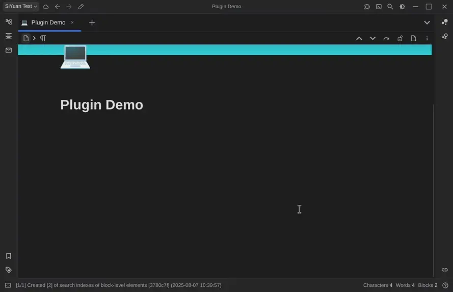

# SiYuan js-draw 插件

本插件可在思源笔记的任意位置内嵌 [js-draw](https://git.boxo.cc/massivebox/js-draw) 白板。

▶️ [LiuYun 帖子](https://liuyun.io/article/1770978310553)

## 功能

- **手写笔支持**：完整的手写笔支持，具备压力灵敏度。
- **明暗模式**：在明/暗模式下绘图，绘图会自动适配思源笔记主题。
- **PDF 导入**：在 PDF 文件的副本上绘制、高亮和编辑。
- **自动保存**：绘图时自动保存。
- **多设备优化**：在一台设备上编辑，通过自动刷新同步到其他设备。
- **完全可定制**：插件设置页面提供所有需要的选项。
- **更多功能**：js-draw 的所有功能均可使用。

计划功能请查看 [Projects](https://git.boxo.cc/massivebox/siyuan-jsdraw-plugin/projects) 标签页！

## 使用说明

在插件市场搜索 `js-draw` 并安装。

### 新建白板

有两种方式新建白板：
- **斜杠命令** — 在文档中输入 `/插入白板`，选择对应菜单项。
- **快捷键 / 工具栏图标** — 在未选中任何白板的情况下按 `Alt+Shift+D` 或点击工具栏图标，将在光标位置插入新白板。默认会弹出确认对话框；可在 **设置 → 未选中白板时的快捷键行为** 中更改（`创建前询问` / `自动创建` / `不执行任何操作`）。

编辑器将在新标签页（移动端为对话框）中打开。随意绘制后，点击 **保存** 并关闭编辑器。

### 编辑白板

左键点击已有的白板将其选中，然后通过以下方式打开编辑器：
- 按 `Alt+Shift+D` 或点击工具栏图标。
- 右键白板（移动端点击三点按钮），选择 **插件 → 编辑白板**。

### 导入 PDF

右键点击笔记中的 PDF 引用，然后选择 **插件 → 导入 PDF 到 JS-Draw 白板**。  
随后将开始导入 PDF，视硬件性能和文档大小不同，可能需要数秒时间。

导入完成后，编辑器会自动打开，可编辑副本的引用链接已复制到剪贴板。  
将其粘贴到笔记中的任意位置即可，之后可像其他 JS-Draw 白板一样正常编辑。

### 未保存的更改

关闭编辑器时若有未保存的更改，更改将被自动保存，您可以选择保留新版本或回滚到之前的版本。

应用退出时也会自动保存未保存的绘图。**注意：** 此紧急保存发生在思源笔记最终同步之后，因此在多设备使用场景下可能导致同步冲突。请养成手动保存后再关闭的习惯。

## 贡献
欢迎任何形式的贡献！  
中文翻译由 AI 完成，因我不懂中文，如有疏漏欢迎指出。  
若您愿意协助，请 [提交 Issue](https://git.boxo.cc/massivebox/siyuan-jsdraw-plugin/issues) 或 [联系我](mailto:box@boxo.cc)。

## 致谢
本项目离不开以下项目与社区的帮助（排名不分先后）：
- [SiYuan](https://github.com/siyuan-note/siyuan) 项目
- 上游 [js-draw](https://github.com/personalizedrefrigerator/js-draw)，本项目所使用的 [fork](https://git.boxo.cc/massivebox/js-draw) 即由其派生
- [SiYuan plugin sample with vite and svelte](https://github.com/siyuan-note/plugin-sample-vite-svelte)
- [siyuan-drawio-plugin](https://github.com/zt8989/siyuan-drawio-plugin) 与 [siyuan-plugin-whiteboard](https://github.com/zuoez02/siyuan-plugin-whiteboard) 提供的灵感与部分代码

也请关注并支持他们！

## 许可证
原始插件框架由思源笔记开发，MIT 许可证。  
本人所作修改版权所有 © 2025 MassiveBox，同样使用 MIT 许可证。